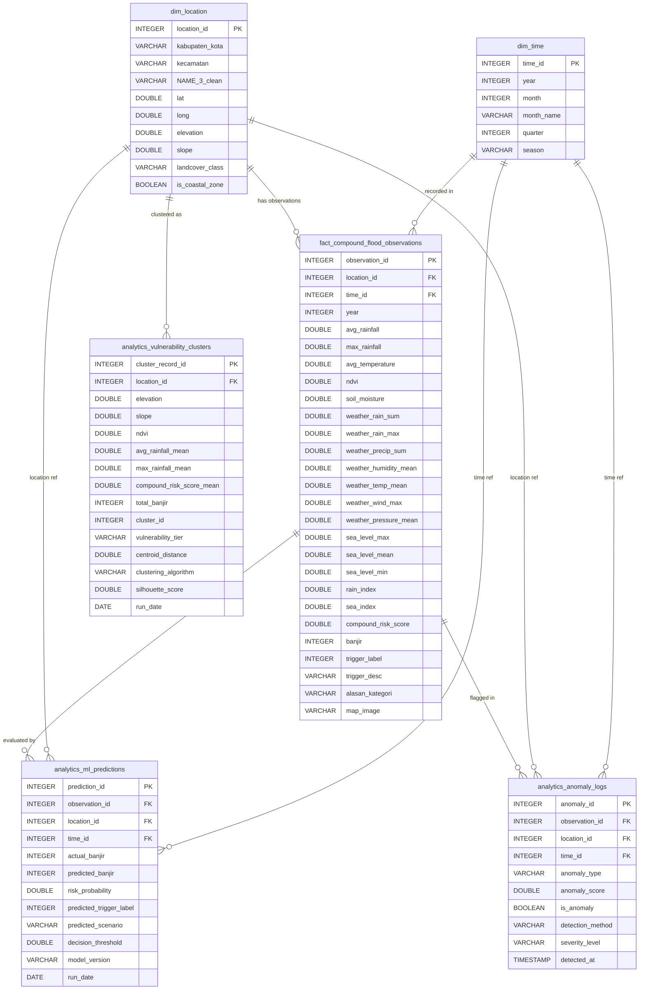

# Jabodetabek Compound Flood BI & Early Warning System

Sistem Business Intelligence, Data Warehouse, dan Machine Learning terpusat untuk analisis serta **Early Warning Dashboard Banjir Majemuk (*Compound Flood*)** di wilayah pesisir Jabodetabek (**Jakarta Utara, Tangerang, dan Bekasi**) untuk periode **2022–2024**.

---

## Ringkasan Proyek & Arsitektur Data (Medallion Architecture)

Proyek ini mengadopsi **Medallion Architecture** agar tim *Data Engineering*, *Data Science/ML*, dan *BI Dashboard* bekerja di atas satu *Single Source of Truth*:

1. **Bronze Layer (`data/raw/`):** Dokumentasi 3 dataset mentah publik dari Kaggle (`Cuaca Per Jam Indonesia`, `Tinggi Muka Air Laut Indonesia`, dan `Kejadian Banjir Jabodetabek`).
2. **Silver Layer (`data/staging/`):** Dataset bulanan terintegrasi [`dataset_compound_flood_ready.csv`](data/staging/dataset_compound_flood_ready.csv) (**2.088 baris × 33 kolom**; 58 kecamatan × 36 bulan) lengkap dengan `rain_index`, `sea_index`, `compound_risk_score`, dan label multi-kelas `trigger_label` (`0 = Aman`, `1 = Hujan Lokal`, `2 = Banjir Rob`, `3 = Compound Flood`).
3. **Gold Layer (`data/warehouse/`):** Data Warehouse berbasis **DuckDB** (`compound_flood_dw.duckdb`) dengan pemodelan **Star Schema**, *analytical SQL views*, tabel output ML/analitik, serta ekspor **Parquet terpartisi per tahun** (`fact_partitioned/year=YYYY/`).

---

## Diagram ERD Star Schema



---

## Struktur Repositori

```text
jabodetabek-compound-flood-bi/
├── data/
│   ├── raw/                  # Dokumentasi 3 dataset mentah Kaggle (Bronze)
│   ├── staging/              # dataset_compound_flood_ready.csv (Silver)
│   └── warehouse/            # compound_flood_dw.duckdb & fact_partitioned/ (Gold)
├── notebooks/                # Eksplorasi & prototipe ETL/ML awal
├── sql/
│   ├── 01_ddl_star_schema.sql
│   └── 02_views_analytics.sql
├── scripts/
│   └── load_warehouse.py     # Loader Star Schema, SQL Views, & ekspor Parquet
├── ml/
│   └── train_and_predict.py  # Pipeline Two-Stage Random Forest + Rule-Based
├── dashboard/                # Aset & implementasi BI Dashboard
├── tests/
│   └── test_warehouse.py     # Validasi integritas DW dengan pytest
├── ARCHITECTURE.md
├── CONTRIBUTING.md
└── requirements.txt
```

---

## Panduan Instalasi & Menjalankan Pipeline

### 1. Instalasi Dependensi

Disarankan menggunakan virtual environment (`.venv`), lalu instal seluruh dependensi Python:

```bash
pip install -r requirements.txt
```

### 2. Membangun Data Warehouse & Ekspor Parquet

Memuat dimensi (`dim_location`, `dim_time`), tabel fakta (`fact_compound_flood_observations`), *analytical views*, dan partisi Parquet tahunan ke `data/warehouse/`:

```bash
python scripts/load_warehouse.py
```

### 3. Menjalankan Pipeline Machine Learning (Two-Stage)

Mengambil data latih pesisir (`elevation <= 15.0`) dari view `vw_ml_coastal_dataset`, melatih model Two-Stage, dan menyimpan hasil prediksi ke tabel `analytics_ml_predictions`:

```bash
python ml/train_and_predict.py
```

### 4. Menjalankan Pengujian Data (`pytest`)

Memverifikasi integritas jumlah baris, *foreign key*, partisi Parquet, SQL views, dan tabel prediksi:

```bash
pytest -v
```

---

## Dokumentasi Lanjutan

- [ARCHITECTURE.md](ARCHITECTURE.md) — Gambaran arsitektur sistem, Medallion layer, dan struktur tim.
- [CONTRIBUTING.md](CONTRIBUTING.md) — Standar engineering, pemodelan data, validasi, serta konvensi commit Git.
